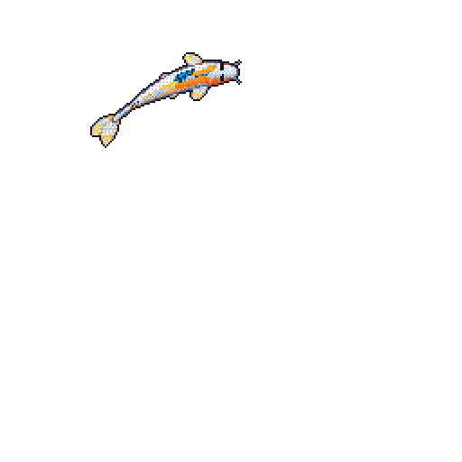

<!-- Landscape banners: generated with {Shan, Shui}* by Lingdong Huang (MIT) — https://github.com/LingDong-/shan-shui-inf -->

  

<h1 align="center">Hey, I'm Octavian 👋</h1>

<h3 align="center">Aspiring Full-Stack Developer · MSc Student in Economic Informatics</h3>

  <em>Mobile &amp; web developer, slowly climbing toward software architecture.</em>

  

  
  

  
  

---

<h2 align="center">🌿 Quick trivia</h2>

<table align="center">
  <tr>
    <td>🎓</td>
    <td>MSc student at the <b>Romanian-American University</b>; Erasmus+ exchange completed at <b>ISEN YNCREA Méditerranée</b> (Toulon, France)</td>
  </tr>
  <tr>
    <td>📱</td>
    <td>Primarily a <b>mobile</b> and <b>web</b> developer: Vue, React, Supabase, Expo React Native, Kotlin</td>
  </tr>
  <tr>
    <td>🏛️</td>
    <td>Aiming to become a <b>Software Architect</b>, actively learning software architecture and backend</td>
  </tr>
  <tr>
    <td>🌱</td>
    <td>Currently working on my master's project and learning mobile development technologies</td>
  </tr>
  <tr>
    <td>💼</td>
    <td>Available for <b>freelance web development</b> work</td>
  </tr>
  <tr>
    <td>📫</td>
    <td>DM me here on GitHub, or on Instagram / LinkedIn</td>
  </tr>
  <tr>
    <td>🎨</td>
    <td>Admirer of French artists such as <b>Monet</b> and <b>Renoir</b></td>
  </tr>
</table>

<h2 align="center">🛠️ Tech I work with</h2>

  
  
  
  
  
  

 

